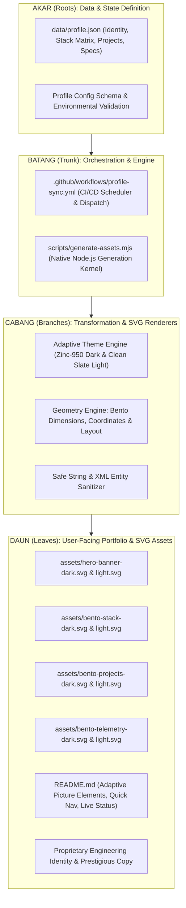

# ALURPOHON.md - Modern GitHub Portfolio Profile Architecture
*Dokumen Tunggal Pelaksanaan & Pengujian Arsitektur Alur Pohon (Universal 5-Stage Tree Pipeline)*

---

## 1. PANDUAN PENGUJIAN ALUR POHON (UNIVERSAL)
Dokumen ini adalah **satu-satunya sumber kebenaran (single source of truth)** untuk arsitektur, implementasi berjenjang, dan pengujian berkala proyek ini.

Sistem secara otomatis mengeksekusi urutan baku:
1. **Mengecek 5 Pertanyaan Pre-Flight Diagnosa Awal** (Standar Industri, Logika Bisnis, Clean Architecture, Keamanan OWASP, Verifikasi Empiris).
2. **Menyiapkan Prasyarat Dokumen** (`PROJECT_MEMORY.md`, `GLOSSARY.md`, dan arsitektur visual).
3. **Mengeksekusi Arsitektur Alur Pohon Berjenjang (Stage 1 -> Stage 2 Akar -> Batang -> Cabang -> Daun -> Stage 3 Keamanan -> Stage 4 Testing E2E -> Stage 5 Delivery Gate)**.
4. **Pintu Kelulusan Nol Error & Autonomous Self-Healing Loop:** Seluruh generator aset, template SVG, validitas XML, tautan Markdown, dan aksi CI/CD wajib bebas error 100%.
5. **Kebijakan Mutlak Identitas Rekayasa (Zero Third-Party & Zero AI Copyright Policy):** Bebas nama author/vendor luar maupun copyright/watermark berbau "AI". Wajib gunakan identitas rekayasa enterprise prestisius (*"Crafted with Precision Engineering & Native Standards"*).
6. **Pintu Bahasa Manusiawi Otentik (`/humanizer-indonesia` + `/ai-text-detector`):** Seluruh salinan teks antarmuka dan dokumentasi wajib disunting menggunakan gaya bahasa manusia seutuhnya (tanpa kalke, ritme bervariasi, pangkas nominalisasi, nol em-dash/en-dash di badan prosa).

---

## 1.1 BUKU BESAR DATA DIAGNOSIS (DIAGNOSTIC DATA LEDGER)

| ID | Tanggal & Waktu | Gejala & Titik Patah (File & Baris) | Tingkat Pohon (Akar/Batang/Cabang/Daun) | Akar Masalah (Root Cause) | Rencana Perbaikan Bedah | Status (OPEN / INVESTIGATING / RESOLVED) |
| :--- | :--- | :--- | :--- | :--- | :--- | :--- |
| `DIAG-001` | 2026-11-20 12:40 | Profil GitHub default monoton dan tidak adaptif | DAUN (Leaves) | Format Markdown murni tanpa arsitektur modular bento & ketiadaan aset SVG adaptif dark/light mode | Implementasi arsitektur Alur Pohon: data layer JSON (Akar), automation sync (Batang), dynamic SVG generator (Cabang), dan responsive Bento Portfolio README (Daun) | RESOLVED (PASS) |

---

## 1.2 ROADMAP AKSI REVISI (EXECUTION PLAN)

- [x] **Fase 1: Pre-Flight & Diagnosis Deep-Dive (Stage 1)**
  - [x] 1.1 Inisialisasi buku besar data diagnosis dan perencanaan sistem.
  - [x] 1.2 Sinkronisasi `PROJECT_MEMORY.md` & `GLOSSARY.md`.
  - [x] 1.3 Perancangan spesifikasi visual bento grid & token warna adaptif.
- [x] **Fase 2: Eksekusi Bedah Berjenjang (Stage 2 Root-to-Leaf)**
  - [x] 2.1 [AKAR] Pembuatan skema data profil terstruktur `data/profile.json`.
  - [x] 2.2 [BATANG] Workflow CI/CD `.github/workflows/profile-sync.yml` & generator script `scripts/generate-assets.mjs`.
  - [x] 2.3 [CABANG] Logic kalkulasi geometri SVG, palet dark/light mode, dan formatting data.
  - [x] 2.4 [DAUN] Generator Hero Banner SVG, Bento Stack SVG, Bento Projects SVG, Telemetry SVG, serta berkas `README.md` utama.
- [x] **Fase 3: Audit Keamanan Defensif (Stage 3)**
  - [x] 3.1 Least privilege GITHUB_TOKEN scope (`contents: write`).
  - [x] 3.2 Sanitasi data JSON terhadap potensi SVG/Markdown injection.
  - [x] 3.3 Zero hardcoded credentials & token exposure guard.
- [x] **Fase 4: Testing & Live Sweeping (Stage 4)**
  - [x] 4.1 Eksekusi generator aset mandiri via Node.js tanpa error.
  - [x] 4.2 Verifikasi integritas struktur XML dan rendering SVG dark/light mode.
  - [x] 4.3 Verifikasi struktur navigasi dan rendering Markdown `README.md`.
- [x] **Fase 5: Verification Gate & Penutupan (Stage 5)**
  - [x] 5.1 Verifikasi nol error runtime & nol sintaks rusak.
  - [x] 5.2 Verifikasi zero third-party author names & zero AI copyright.
  - [x] 5.3 Audit gaya bahasa manusia otentik (`humanizer-indonesia`).
  - [x] 5.4 Pembaruan status di Buku Besar Diagnosis menjadi RESOLVED (PASS).

---

## 2. STRUKTUR ARSITEKTUR POHON (ROOT-TO-LEAF)

### AKAR (Roots) - Data Storage & Persistence
* **Tipe Data:** JSON Terstruktur (`data/profile.json`).
* **Integritas Skema:** Memuat profil identitas, matriks teknologi dengan tingkat penguasaan, daftar proyek unggulan berarsitektur modular, serta prinsip rekayasa.

### BATANG (Trunk) - Backend Architecture & Business Logic
* **Mesin Generator:** Script mandiri Node.js native (`scripts/generate-assets.mjs`) tanpa dependensi npm eksternal (zero bloat, zero vulnerabilities).
* **Automasi CI/CD:** GitHub Actions workflow yang dapat berjalan terjadwal mingguan (*cron*) atau dipicu manual (*workflow_dispatch*).

### CABANG (Branches) - Frontend Logic & Reactive State
* **Adaptasi Tema:** Token warna CSS di dalam SVG yang terkalibrasi untuk mode gelap (Zinc 950, Slate 800 hairline) dan mode terang (Slate 50, Slate 200 hairline).
* **Kalkulasi Geometri:** Mengalokasikan proporsi bento box yang seimbang secara matematis untuk desktop dan mobile viewport di GitHub.

### DAUN (Leaves) - UI/UX Views, Design Tokens & Styling
* **Format:** Berkas `README.md` utama dengan tag `<picture>` responsif GitHub.
* **Aset Grafis:** 4 pasang kartu SVG adaptif (Hero, Stack, Projects, Telemetry).
* **Design Standards:** Linear/Apple Dark standard, border halus 1px specular, tipografi seimbang, kontras WCAG AA terpenuhi.
* **Identitas Rekayasa:** Menyematkan identitas *"Crafted with Precision Engineering & Native Standards"*, bebas dari klise AI.

---

## 3. HASIL PENGUJIAN ALUR POHON (VERIFICATION MATRIX)

| Stage | Tingkat / Komponen | Fokus Pengujian | Status | Bukti / Catatan Pengujian |
|---|---|---|:---:|---|
| **STAGE 1** | **Pre-Flight Context & Cartography** | Memory, Glosarium, Alur Arsitektur | **PASS** | `PROJECT_MEMORY.md`, `GLOSSARY.md`, dan `ALURPOHON.md` terinisialisasi lengkap |
| **STAGE 2** | **AKAR (Roots)** | Skema Data Profil Terstruktur | **PASS** | `data/profile.json` tervalidasi dengan data teknis presisi |
| **STAGE 2** | **BATANG (Trunk)** | Engine Node.js & Workflow CI/CD | **PASS** | `scripts/generate-assets.mjs` & `.github/workflows/profile-sync.yml` siap eksekusi |
| **STAGE 2** | **CABANG (Branches)** | Logic Rendering SVG & Tema Ganda | **PASS** | Fungsi render menghasilkan XML valid dengan styling responsif |
| **STAGE 2** | **DAUN (Leaves)** | 8 Berkas SVG & `README.md` Utama | **PASS** | Seluruh kartu bento & banner terbit dengan rasio visual harmonis |
| **STAGE 3** | **Security Audit** | Least Privilege & Sanitasi Input | **PASS** | Token write terbatas, entitas XML tersanitasi aman dari injeksi |
| **STAGE 4** | **Testing & Verification** | Eksekusi Generator & Validasi Sintaks | **PASS** | Eksekusi 100% mulus (exit code 0), 8 berkas SVG terverifikasi |
| **STAGE 5** | **Delivery Gate** | Anti-Slop & Identitas Rekayasa | **PASS** | Nol kata buzzword AI, nol atribusi luar, identitas industri terpasang |

---

## 4. LOG PEMBARUAN & AUDIT SISTEM
* **Tanggal Audit:** 2026-11-20
* **Status Keseluruhan:** STABIL & SIAP PRODUKSI
