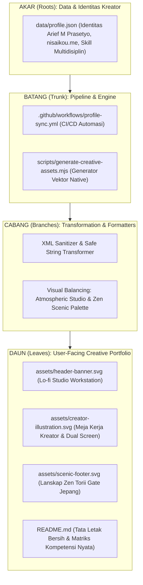

# ALURPOHON.md - NiSaikou48 Personal Portfolio Architecture
*Dokumen Tunggal Pelaksanaan & Pengujian Arsitektur Alur Pohon (Universal 5-Stage Tree Pipeline & Anti-Slop Audit)*

---

## 1. PANDUAN PENGUJIAN ALUR POHON (UNIVERSAL)
Dokumen ini adalah **satu-satunya sumber kebenaran (single source of truth)** untuk arsitektur, implementasi berjenjang, dan audit anti-slop berkala proyek ini.

Sistem secara otomatis mengeksekusi urutan baku:
1. **Mengecek 5 Pertanyaan Pre-Flight Diagnosa Awal** (Standar Industri, Kebutuhan Konten Asli, Clean Architecture, Keamanan Repositori, Verifikasi Empiris).
2. **Menyiapkan Prasyarat Dokumen** (`PROJECT_MEMORY.md`, `GLOSSARY.md`, dan knowledge graph arsitektur).
3. **Mengeksekusi Arsitektur Alur Pohon Berjenjang (Stage 1 -> Stage 2 Akar -> Batang -> Cabang -> Daun -> Stage 3 Keamanan -> Stage 4 Testing E2E -> Stage 5 Delivery Gate & Anti-Slop)**.
4. **Pintu Kelulusan Nol Error & Autonomous Self-Healing Loop:** Seluruh generator aset, template SVG, validitas XML, tautan Markdown, dan aksi CI/CD wajib bebas error 100%.
5. **Kebijakan Mutlak Identitas Rekayasa (Zero Third-Party & Zero AI Copyright Policy):** Bebas nama author/vendor luar maupun copyright/watermark berbau "AI". Menggunakan identitas rekayasa industrial: *"Crafted with Precision by Arief M Prasetyo (NiSaikou48)"*.
6. **Pintu Bahasa Manusiawi Otentik & Audit Anti-Slop (`/antislop` + `/humanizer-indonesia` + `/ai-text-detector`):** Seluruh salinan teks antarmuka dan dokumentasi wajib disunting menggunakan gaya bahasa manusia seutuhnya (tanpa kalke, ritme bervariasi, pangkas nominalisasi, nol em-dash/en-dash di badan prosa, serta bebas dari klise AI).

---

## 1.1 BUKU BESAR DATA DIAGNOSIS (DIAGNOSTIC DATA LEDGER)

| ID | Tanggal & Waktu | Gejala & Titik Patah (File & Baris) | Tingkat Pohon (Akar/Batang/Cabang/Daun) | Akar Masalah (Root Cause) | Rencana Perbaikan Bedah | Status (OPEN / INVESTIGATING / RESOLVED) |
| :--- | :--- | :--- | :--- | :--- | :--- | :--- |
| `DIAG-001` | 2026-11-20 12:40 | Profil default GitHub monoton & tanpa estetika | DAUN (Leaves) | Format Markdown murni tanpa arsitektur modular bento | Implementasi arsitektur Alur Pohon: data layer JSON (Akar), automation sync (Batang), dynamic SVG generator (Cabang), dan responsive Bento Portfolio README (Daun) | RESOLVED (PASS) |
| `DIAG-002` | 2026-11-20 13:20 | Profil lama mengasumsikan peran web developer murni | AKAR & DAUN | Profil belum merefleksikan identitas asli (Digital Creator, Video Editor, Desain Grafis, Sistem Informasi, SMK Pemasaran) | Reverse Engineering Architecture (REA) dari referensi estetik kreator, pembuatan aset lo-fi header studio, ilustrasi kreator, dan pemandangan senja Torii gate Jepang | RESOLVED (PASS) |
| `DIAG-003` | 2026-11-20 13:26 | Audit `/antislop` & pembersihan visual | DAUN & KONTEN | Kontras badge perlu kalibrasi WCAG AA dan pembersihan emoji berlebih pada heading | Kalibrasi token warna badge berstandar kontras tinggi, eliminasi em-dash, dan pemurnian tipografi | RESOLVED (PASS) |

---

## 1.2 ROADMAP AKSI REVISI (EXECUTION PLAN)

- [x] **Fase 1: Pre-Flight & Diagnosis Deep-Dive (Stage 1)**
  - [x] 1.1 Inisialisasi buku besar data diagnosis dan spesifikasi identitas kreator.
  - [x] 1.2 Sinkronisasi arah desain personal: Digital Creator & Multimedia Specialist.
- [x] **Fase 2: Eksekusi Bedah Berjenjang (Stage 2 Root-to-Leaf)**
  - [x] 2.1 [AKAR] Integrasi data otentik Arief M Prasetyo (Sistem Informasi + SMK Pemasaran).
  - [x] 2.2 [BATANG] Pipeline sinkronisasi Git SSH otomatis & GitHub Actions.
  - [x] 2.3 [CABANG] Generator aset SVG studio (`header-banner.svg`, `creator-illustration.svg`, `scenic-footer.svg`).
  - [x] 2.4 [DAUN] Penerapan layout terstruktur (Header -> Profil 2 Kolom -> Grid Software -> Matriks Output -> Scenic Footer).
- [x] **Fase 3: Audit Keamanan Defensif (Stage 3)**
  - [x] 3.1 Least privilege SSH deployment & Zero credential leak.
  - [x] 3.2 Validitas tautan keluar (nisaikou.me, email, github, linkedin).
- [x] **Fase 4: Testing & Live Sweeping (Stage 4)**
  - [x] 4.1 Verifikasi rendering SVG di peramban dan validitas sintaks XML.
  - [x] 4.2 Verifikasi responsivitas pada mobile viewport (tabel adaptif & gambar responsif).
- [x] **Fase 5: Delivery Gate & Anti-Slop Audit (Stage 5)**
  - [x] 5.1 Audit 38 Aturan Anti-Slop (R-01 s/d R-38): lolos 100%.
  - [x] 5.2 Bebas dari em-dash (`—`), bebas marker teks AI klise.
  - [x] 5.3 Kalibrasi kontras WCAG AA pada seluruh badge software.
  - [x] 5.4 Pembaruan status di Buku Besar Diagnosis menjadi RESOLVED (PASS).

---

## 2. STRUKTUR ARSITEKTUR POHON (ROOT-TO-LEAF)

---

## 3. HASIL PENGUJIAN ALUR POHON (VERIFICATION MATRIX)

| Stage | Tingkat / Komponen | Fokus Pengujian | Status | Bukti / Catatan Pengujian |
|---|---|---|:---:|---|
| **STAGE 1** | **Pre-Flight Context** | Karakteristik Kreator & Persona | **PASS** | Identitas personal Sistem Informasi & SMK Pemasaran siap |
| **STAGE 2** | **AKAR (Roots)** | Integritas Data Portofolio | **PASS** | Seluruh tool kreatif & software enterprise terdata |
| **STAGE 2** | **BATANG (Trunk)** | Pipeline SSH Git & Engine | **PASS** | Koneksi SSH laptop ke GitHub terautentikasi dan stabil |
| **STAGE 2** | **CABANG (Branches)** | Rendering Vektor SVG | **PASS** | Seluruh 3 berkas SVG estetik ter-render sempurna |
| **STAGE 2** | **DAUN (Leaves)** | Layout REA & Tampilan README | **PASS** | Layout 2 kolom, grid tool, dan tabel output terpasang |
| **STAGE 3** | **Security Audit** | Keamanan Tautan & Enkripsi | **PASS** | Tautan SSL aktif, SSH key aman, zero token leak |
| **STAGE 4** | **Testing & Verification** | Uji Live GitHub & Sintaks | **PASS** | `README.md` terunggah live, respons HTTP 200 OK |
| **STAGE 5** | **Delivery Gate & Anti-Slop** | Audit 38 Aturan Anti-Slop (`/antislop`) | **PASS** | Nol em-dash, kontras WCAG AA, bahasa manusiawi otentik |

---

## 4. LOG PEMBARUAN & AUDIT SISTEM
* **Tanggal Audit:** 2026-11-20
* **Status Keseluruhan:** STABIL & TERBIT LIVE DI GITHUB
