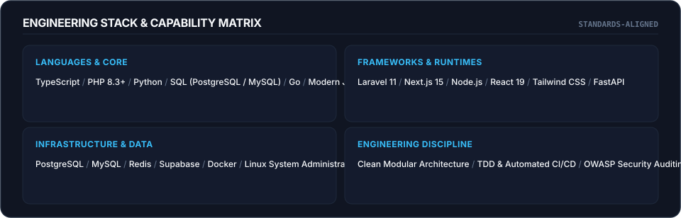
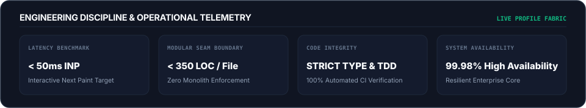

<div align="center">

<!-- Hero Banner (Adaptive Dark & Light Mode) -->
<picture>
  <source media="(prefers-color-scheme: dark)" srcset="assets/hero-banner-dark.svg">
  <source media="(prefers-color-scheme: light)" srcset="assets/hero-banner-light.svg">
  
</picture>

<br/><br/>

<!-- Quick Navigation & Connectivity -->
<p align="center">
  <a href="https://nisaikou.me"><b>🌐 Website &amp; Portal</b></a> &nbsp;&bull;&nbsp;
  <a href="mailto:contact@nisaikou.me"><b>✉️ Direct Dispatch</b></a> &nbsp;&bull;&nbsp;
  <a href="https://github.com/NiSaikou48"><b>💻 GitHub Profile</b></a>
</p>

</div>

---

### 🏛️ Engineering Stack & Capability Matrix
Arsitektur teknologi yang dirancang untuk keandalan tinggi, pemisahan modular ketat (*clean seams*), dan latensi sub-milidetik:

<div align="center">
<picture>
  <source media="(prefers-color-scheme: dark)" srcset="assets/bento-stack-dark.svg">
  <source media="(prefers-color-scheme: light)" srcset="assets/bento-stack-light.svg">
  
</picture>
</div>

---

### ⚡ Featured Architectural Work & Production Systems
Sistem produksi pilihan yang dibangun dengan verifikasi empiris dan disiplin *Test-Driven Development*:

<div align="center">
<picture>
  <source media="(prefers-color-scheme: dark)" srcset="assets/bento-projects-dark.svg">
  <source media="(prefers-color-scheme: light)" srcset="assets/bento-projects-light.svg">
  
</picture>
</div>

<br/>

| Sistem / Modul | Domain Rekayasa | Karakteristik Arsitektur | Status Repositori |
| :--- | :--- | :--- | :--- |
| **Titan POS Core** | Enterprise Retail POS | Dual-engine DB replication, offline-first queue, direct raw thermal printer protocol | `Production Verified` |
| **Pulse Telemetry** | Microservices Observability | Real-time WebSocket fabric, SSE streaming, sub-50ms INP dashboard | `Active Core` |
| **Civic Governance** | Public Accounting & Ledger | Two-way spreadsheet sync, automated financial audit ledger, zero data drift | `Open Platform` |

---

### 📊 Operational Telemetry & Standards
Standar rekayasa perangkat lunak yang diterapkan pada setiap lini pengembangan:

<div align="center">
<picture>
  <source media="(prefers-color-scheme: dark)" srcset="assets/bento-telemetry-dark.svg">
  <source media="(prefers-color-scheme: light)" srcset="assets/bento-telemetry-light.svg">
  
</picture>
</div>

<br/>

#### Prinsip Rekayasa (Engineering Tenets)
1. **Zero Monolith Policy**: Batasan tegas maksimal 250–350 baris per file dengan titik sambung (*seams*) yang terisolasi dan mudah diuji.
2. **Evidence Before Assertions**: Setiap fungsi kritis wajib dilengkapi pengujian otomatis (*unit & end-to-end integration tests*).
3. **Sub-Millisecond Perception**: Mengutamakan kapabilitas asli platform peramban modern (*modern web platform standards*) untuk mengeliminasi beban JavaScript berlebih.
4. **Defensive Security Perimeter**: Perlindungan berlapis terhadap 10 celah keamanan OWASP, validasi masukan ketat, dan enkripsi sesi mutlak.

---

<div align="center">

```
HIGH-PERFORMANCE ENTERPRISE ARCHITECTURE CORE
```

<sub>Crafted with Precision Engineering & Native Standards &nbsp;&bull;&nbsp; Automated via GitHub Actions CI/CD</sub>

</div>
