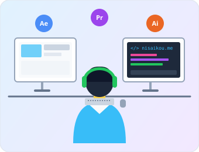

<!-- Top Banner (Aesthetic Lo-fi Creative Workstation) -->

  

<!-- Main Greeting -->
# Halo! 🙏 Saya Arief M Prasetyo

  <b>Digital Content Creator &bull; Video &amp; Motion Editor &bull; Graphic Designer &bull; Systems Information &amp; Marketing Strategist</b>

  <i>Perpaduan antara lulusan <b>Sarjana Sistem Informasi</b> dan latar belakang <b>SMK Manajemen Pemasaran</b>. 
  Fokus pada produksi media kreatif digital, kurasi editorial di <b><a href="https://nisaikou.me">nisaikou.me</a></b>, desain visual grafis, serta otomatisasi workflow dokumen enterprise.</i>

---

### 💫 About Me

<table>
  <tr>
    <td width="65%" valign="top">
      <ul>
        <li>🎓 <b>Edukasi &amp; Latar Belakang:</b> Lulusan Sistem Informasi dengan pemahaman mendalam tentang arsitektur perangkat lunak, serta fondasi kuat dari SMK Manajemen Pemasaran untuk strategi audiens &amp; branding.</li>
        <li>🎬 <b>Video Editing &amp; Motion Design:</b> Mengolah video sinematik, konten media sosial dinamis, dan efek visual menggunakan <i>Premiere Pro, After Effects, CapCut</i>, dan <i>DaVinci Resolve</i>.</li>
        <li>🎨 <b>Desain Grafis &amp; Vektor:</b> Merancang ilustrasi, logo, visual branding, dan layout promosi dengan <i>Adobe Illustrator, Photoshop</i>, dan <i>Affinity Designer</i>.</li>
        <li>🌐 <b>Digital Publication:</b> Founder &amp; kreator di balik portal media <b><a href="https://nisaikou.me">nisaikou.me</a></b> (konten editorial, optimasi SEO/AEO, dan tren pop-culture).</li>
        <li>📊 <b>Office &amp; Enterprise Software:</b> Manajemen dokumen &amp; data analitik tingkat lanjut menggunakan <i>Word, PowerPoint, Excel / Spreadsheets</i>, serta pemodelan <i>Enterprise Architecture</i>.</li>
      </ul>
       
      <b>📫 Hubungi Saya:</b> 
      
      
      
      
    </td>
    <td width="35%" align="center" valign="middle">
      
    </td>
  </tr>
</table>

---

### 🧰 Creative &amp; Software Arsenal

<!-- Visual Badges Matrix -->

  
  
  
  
  
  
  

  
  
  
  
  
  

  
  
  
  
  
  
  

---

### 🛠️ Kategori Keahlian &amp; Bidang Pekerjaan:

| Bidang Kreatif &amp; Teknis | Perangkat Lunak &amp; Tools | Output &amp; Penerapan Kerja |
| :--- | :--- | :--- |
| 🎬 **Video Editing &amp; Motion** | Premiere Pro, After Effects, CapCut, DaVinci Resolve | Video promosi, reels/shorts viral, color grading, motion title, editing alur cerita |
| 🎨 **Desain Grafis &amp; Vektor** | Illustrator, Photoshop, Affinity Designer, Figma | Aset banner web, poster event, identitas brand, ilustrasi vektor, UI mockup |
| 🌐 **Media Portal &amp; Web** | nisaikou.me, WordPress, HTML5/CSS3, PHP, MySQL | Manajemen konten artikel, kurasi berita, integrasi visual, optimasi SEO on-page |
| 📑 **Office &amp; Dokumentasi** | MS Word, PowerPoint, Excel, Google Workspace | Pembuatan modul LPJ, slide presentasi bisnis elegan, data tabular formula lanjutan |
| 🏛️ **Sistem &amp; Pemasaran** | Enterprise Architecture, Marketing Strategy | Analisis proses bisnis, pemetaan kebutuhan sistem informasi, strategi riset pasar |

---

### ☕ Connect &amp; Support

  

<!-- Scenic Japanese Landscape / Torii Gate Footer Banner -->

 

Crafted with Precision by Arief M Prasetyo (NiSaikou48) &bull; Founder of <a href="https://nisaikou.me">nisaikou.me</a>

